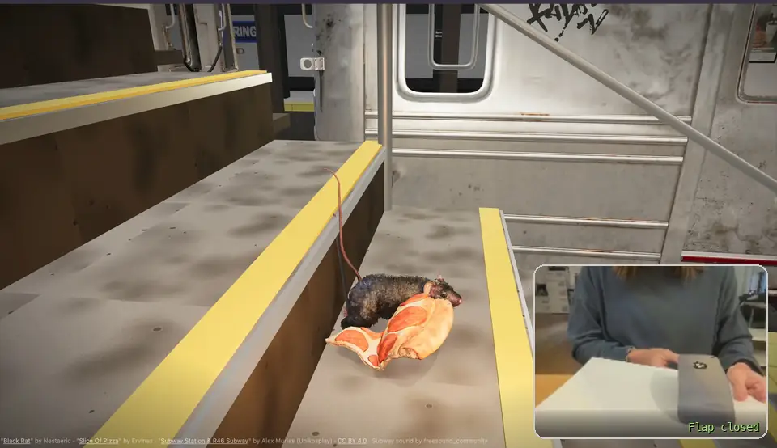

# Pizza Rat 🍕🐀

A paper controller that triggers a digital action through the webcam (IxD assignment).

New York's famous Pizza Rat drags a slice down an endless staircase at Spring Street station (6 train). Pull the flap on a **paper phone** and you "take his picture": the camera flashes, the rat drops the slice and bolts to hide behind the stairs. Close the flap and he peeks out, sneaks back, grabs his slice and keeps going.

**Try it live:** https://cstandifer.github.io/pizza-rat/ (allow the camera; no tag? hold the space bar)



*The paper phone flips up to face the webcam, the tracker finds the tag inside the apple ("Tag 0 — flap pulled!"), and Pizza Rat drops his slice and hides. When the phone goes back down he sneaks back for it. The webcam view in the corner is enlarged in this clip so you can see the paper phone.*

---

## The paper controller

The controller has two states:

| Flap | What the webcam sees | What happens |
|---|---|---|
| **Closed** | No tag | Pizza Rat keeps dragging his slice down the stairs |
| **Pulled** | An ArUco tag | Camera flash and phone-camera overlay (REC, view counter). He drops the slice and hides |

The tag is hidden **inside an Apple logo** on the paper phone: a solid black apple with **ArUco tag 0 from the 6x6 dictionary** printed in it. The tag's black border melts into the apple's black, so it reads as part of the logo. The project includes its own reader for that (see [How it works](#how-it-works)).

### The apple tag: print your own

<a href="docs/apple-tag-0.png"></a>

**[Download the apple tag (PNG, 1440 × 1680)](https://github.com/cstandifer/pizza-rat/raw/main/docs/apple-tag-0.png)**. It's print quality, so you can also right-click the image above to copy or save it.

Printing tips:

- Keep the apple solid black, with white paper around it.
- Make the apple about 6 cm (2.5 in) tall or bigger, and hold it within arm's length of the laptop camera.
- Any normal 6x6 tag printed with a white margin also works. Set `triggerId` to its number (or `null` for any tag).

## Run it

**Online:** open the live link above in Chrome and allow camera access.

**Locally:** you need Python 3 (built into macOS).

```bash
python3 serve.py
```

Then open http://localhost:8123 and click **Start**. The browser needs a click before it can play sound.

| Key | Does |
|---|---|
| **Space** (hold) | Fakes the tag, for testing without the paper phone |
| **H** | Hides or shows the small webcam preview |
| **T** | Calls a train now |

`serve.py` is a tiny server that tells the browser never to cache files. With a normal server, a regular reload can keep running old JavaScript after you change the code.

## Settings

Everything you'd want to tweak is in the `CONFIG` block at the top of [js/main.js](js/main.js):

| Setting | What it does |
|---|---|
| `tagDictionary` | `'ARUCO_6X6_1000'` (6x6 tags) or `'ARUCO'` (the "Original ArUco" tags from the class base code) |
| `triggerId` | Which tag fires the flash (`0` = the apple tag; `null` = any tag) |
| `tagInShape` | Also find a tag printed inside a solid black shape, like the apple |
| `walkSpeed`, `runSpeed` | How fast he walks down the stairs and bolts to hide |
| `minHideTime`, `peekEvery` | How long he stays hidden and how often he peeks |
| `stationName`, `mosaicName`, `plaqueName`, `line`, `lineColor` | The station's signs |

## How it works

| File | What's in it |
|---|---|
| [index.html](index.html), [css/style.css](css/style.css) | Page, start screen, phone-camera overlay, flash, webcam preview |
| [js/main.js](js/main.js) | The 3D scene (Three.js), the rat's behaviour (walk, step down, sit up at edges, startle, flee, hide, peek, return), his head, jaw and tail, and carrying the slice |
| [js/ratphysics.js](js/ratphysics.js) | The rat's body as a real rigid body falling under gravity, so stepping off each stair is physics, not a scripted animation |
| [js/pizza.js](js/pizza.js) | The floppy slice: a chain of points that bends over step edges and drags behind him |
| [js/station.js](js/station.js) | Spring Street station: platform, tracks, columns, signs, mosaics, and trains with doors timed to the recording |
| [js/textures.js](js/textures.js) | Textures drawn in code (concrete, tile, signs) |
| [js/sound.js](js/sound.js) | The station recording plus action sounds (shutter, squeak, scurry, pizza scrape) |
| [js/tracker.js](js/tracker.js) | Webcam, ArUco detection, and smoothing so a single bad frame can't fire the flash or close the flap |
| [js/shapetag.js](js/shapetag.js) | Finds a tag hidden inside a black shape (the apple) |
| [serve.py](serve.py) | No-cache local server |

**Tag detection.** The tracker uses [js-aruco2](https://github.com/damianofalcioni/js-aruco2), a fork of the js-aruco library in the class base code that can also read OpenCV's 6x6 tags. The flap counts as "pulled" after the tag is seen in 3 detections in a row, and "closed" after it's missing for 30 (about one second). Paper flutter and webcam flicker don't trigger anything.

**The tag inside the apple.** A normal ArUco reader starts by finding the white edge around a tag's black border. Inside the apple there isn't one. So [js/shapetag.js](js/shapetag.js):

1. Sorts the picture into light and dark, judging each spot against its surroundings, so shadows don't matter.
2. Finds white spots completely enclosed by one dark shape: the tag's white squares inside the apple.
3. Fits the tightest box around them. That box is the tag's 6x6 grid, and each side is fitted separately so a tilted phone still lines up.
4. Grows the box by one square for the black border.
5. Hands it to the normal ArUco reader, which checks the border and reads the code.

The finder only works when a tag's white squares reach all four sides of its grid. Tag 0's do.

**Gravity.** He's simulated as a 2D rigid body (position-based dynamics, after Müller et al., *Detailed Rigid Body Simulation with Extended Position Based Dynamics*, 2020):

- real gravity (9.8 m/s²)
- paws that grip and push him forward
- a belly that slides over step noses
- muscles that only work while a paw is on the ground

When his weight passes a step's edge, he tips over and falls until his front paws land, then his back end slides off and drops.

---

## How we got here

This was built over two days (November 8–9, 2026), through about 50 rounds of direction and feedback.

### 1. Ideas and concept

- **Starting point:** the class base code, a webcam paper controller using js-aruco and the "Original ArUco" tags. We compared tracking options (ArUco, js-aruco2, MediaPipe hands/face/pose and others) and brainstormed controllers.
- **Darker, more punk:** the first ideas were too cute, so we pushed toward zine and punk-flyer energy: paper pedalboards, trash animals and NYC grime.
- **A flap is a trigger.** The physical controller is a flap, so the design became "start hidden, pull to trigger." Trash animals led to **Pizza Rat**.
- **What scares the rat?** Options included a train arriving, a boot stomp, a bodega cat, a flashlight and a **phone camera flash**. We chose the flash: the paper controller becomes a paper phone, and pulling its flap "takes his picture."
- **Storyboards:** four concepts (phone flash, bodega cat, train, flashlight), each in four panels: idle, pull, trigger, aftermath. Then stills in 3–5 visual styles.

### 2. Choosing the medium

- The drawn styles were too basic. The goal was a **3D animated-film look**, with the video reacting live to the paper controller.
- Options weighed: Adobe (Firefly image/video) with pre-rendered clips, a game engine, or **real-time 3D in the browser**. We went with **Three.js in the browser** and real 3D models from Sketchfab, so the rat can react any time instead of only switching between clips.

### 3. First working scene

- **The rat model** came from Sketchfab as a `.glb` with 12 animations (walks, runs, idles). Its textures were shrunk so it loads fast (32 MB to 12 MB). **The pizza model** went from 7.9 MB to 1.6 MB, with its material fixed for the browser.
- **The first build:** endless subway stairs, the rat walking down with the slice, and the full flash → drop → flee → hide → peek → return loop, with a space-bar stand-in for the tag.

### 4. The station

- **The background didn't make sense** (a wall he could somehow hide behind). The staircase was opened up over a subway platform, with tracks, columns and a tiled wall. He hops over the edge to hide.
- **Trains and sound:** the express-train recording was charted for loudness, and the train is timed to it: headlights during the build-up, nose arriving at about 4 s, tail clearing at about 15.5 s.
- **A real station model:** the R46 station from Sketchfab was 250 MB, 1.1 million triangles and 177 textures. Removing everything the camera never sees (tunnel, ceiling pipes, train seats, cab) and shrinking textures brought it to 30.5 MB.
- **Which station:** it was East Broadway (F) at first, then changed to **Spring Street on the 6 train** to match a reference photo. That added green columns, two-line station signs, "SPRING ST." mosaics, blue tile bands and small plaques.
- **Doors timed to the recording:** the train stops at 68.5 s, the announcement plays, the chime sounds at 97.5 s and it leaves at 110.5 s.
- **Fixes:**
  - flicker at the base of the far wall (z-fighting: two surfaces 2 mm apart at 17 m)
  - glitchy runs back to the slice (he spun 180° when re-grabbing it)
  - webcam flicker making him climb out too early

### 5. Getting him down the stairs: the long part

This took the most rounds. Each problem we saw led to the next fix:

1. **Walking through the pizza:** the slice now knows where his body is (a capsule it can't pass into) and trails beside him.
2. **Sinking into the stairs:** his pose now comes from where his front and back paws are, with his belly and chin checked against the steps every frame.
3. **"Moonwalking" over the drop:** first a step routine (cross, pause at the edge, hop). That was too jerky, so it became a continuous step-down using the rig's spine-stretch bones.
4. **Head not bending, body stiff as a plank:** his head and front paws turned out to hang off the root bone, so they were grouped with the chest. His back now curves progressively from hips to shoulders.
5. **Paws stretching, too slow, back should bend the other way on landing:** paw stretching removed, faster pace, and a reverse sway when his front lands first.
6. **Descent starting in mid-air:** he now starts leaning as his nose passes the edge.
7. **Front legs walking out over the drop:** each pair of legs is animated separately. The front legs reach down while the back legs keep walking.
8. **Floating, always tilted:** gravity-driven slide and drop, and he levels out on every landing.
9. **Reference frames from the real Pizza Rat video:** these changed how he holds the slice (by the crust).
10. **Hovering above the landing:** the code now measures the real paw bones every frame and plants them.
11. **"Am I seeing old code?"** The browser was caching JavaScript, so we added the no-cache `serve.py`.

### 6. Real gravity

The step-down still looked scripted ("as soon as his body dips off the stairs, gravity should bring him down"). So the animation was replaced with **real physics**: [js/ratphysics.js](js/ratphysics.js) simulates his body as a rigid body under gravity, with contact points for the paws, belly and nose. Getting it stable took several fixes:

- exploding on the first frame (his rump started inside a step)
- being launched off a step corner
- somersaulting, then balancing on his chest like a Segway (his centre of mass was moved back)
- his nose propping him up
- his back end hovering, because the body's size measurement included his tail

### 7. Making him feel alive

- The pizza is **dragged beside and behind him**, as in the real video, **held by the crust edge in his mouth**: pinned at his front teeth, with his jaw opened.
- He **sits up at edges** sometimes (not every step) and **doesn't stop at every step**.
- **Back legs bound** like jumping and stepping as he goes over an edge. **Front paws land and walk** on the step below.
- **Tail:** a springy chain that lags, droops, swishes and folds. (The model's tail bones had dots stripped from their names, so the first version never moved.)
- **His back half drops level** right after it comes off the step.
- **Front legs don't scurry** faster than he's actually moving. The walk cycle's speed follows his real speed, so his paws don't skate.
- **Bigger, more natural strides** across each step: the walk animation is exaggerated 1.35×.
- **His head turns and tugs** toward the slice like it has weight, with a tug on every stride, and the slice was made a little less floppy.

### 8. Sound

- **The only background sound is the real station recording.** Random sirens and a "train whistle" turned out to come from synthesized background sounds in the code, not the recording. Checking the original confirmed it, so the synthesized background was removed. Only action sounds remain (shutter, squeak, scurry, pizza scrape).

### 9. The ArUco tag

- **6x6 instead of "Original":** the printed tag was from the 6x6 dictionary, which the class base code's library can't read. Switched to js-aruco2. Its 6x6 codes were checked against OpenCV's official dictionary (all 1,000 match), so tag IDs from any online generator are the same here.
- **Tested on drawn tags:**
  - rotated, blurred, noisy and small tags all read
  - none of 1,800 random black-and-white patterns were mistaken for a 6x6 tag (the original dictionary misread 28 of the same patterns)
- **The tag inside the apple:** the normal reader can't see it, so [js/shapetag.js](js/shapetag.js) was written to find it (see [How it works](#how-it-works)). The trigger was set to tag 0. It was tested on the apple near, far, rotated, upside down, tilted, blurred, shadowed and in clutter, plus 960 fake apples with random patterns (no false flashes).
- **Speed-ups:**
  - the apple finder went from about 16 ms to 2–4 ms per frame (row runs instead of pixel-by-pixel region filling)
  - the library's code lookup became about 50× faster (bit math, with identical answers)
- **Confirmed working** with the real webcam and the printed paper phone.

---

## How this was made

**Caitlin Standifer directed this project**, and the code was written by [Claude Code](https://claude.com/claude-code), Anthropic's AI coding agent. Caitlin:

- chose the concept and the trigger
- made the design calls
- found and supplied the 3D models, the sound recordings, the station reference photo, frames from the real Pizza Rat video and the ArUco tag
- designed and built the paper phone
- tested every version and gave the feedback that drove each change

Claude Code wrote and tested the code from that direction.

## Credits

- "[Black Rat](https://sketchfab.com/3d-models/black-rat-free-download-3db3acb4140d4de8bd62a171212bad9c)" by Nestaeric, [CC BY 4.0](http://creativecommons.org/licenses/by/4.0/)
- "[Slice Of Pizza](https://sketchfab.com/3d-models/slice-of-pizza-b8c251d79e104922bc0497a5d2fdf822)" by Ervinas, [CC BY 4.0](http://creativecommons.org/licenses/by/4.0/)
- "[Subway Station & R46 Subway](https://sketchfab.com/3d-models/free-subway-station-r46-subway-ae5aadde1c6f48a19b32b309417a669b)" by Alex Murias (Unikosplay), [CC BY 4.0](http://creativecommons.org/licenses/by/4.0/). Trimmed for the browser; the full original isn't included because it's too big for GitHub.
- "NYC Subway" and "Subway Passing" sound recordings by freesound_community, via [Pixabay](https://pixabay.com/)
- [Three.js](https://threejs.org/) r160
- [js-aruco2](https://github.com/damianofalcioni/js-aruco2) 2.0.0, a fork of [js-aruco](https://github.com/jcmellado/js-aruco) (the class base code's tracker)
- ArUco 6x6 dictionary from [OpenCV](https://github.com/opencv/opencv)
